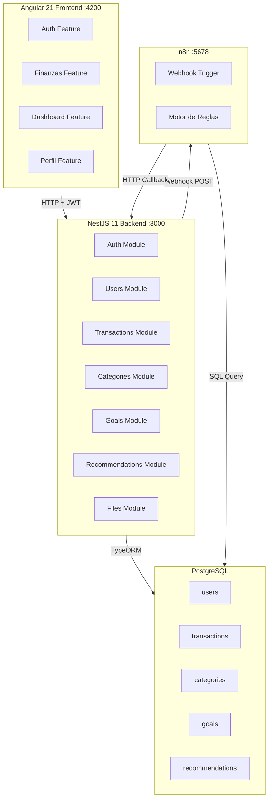

# 🧾 Caudo — Plan de Implementación

Aplicación web de finanzas personales con IA para el consumidor colombiano.  
**Stack**: Angular 21 + NestJS 11 + PostgreSQL + n8n + JWT

---

## Estado Actual

| Proyecto | Estado | Notas |
|----------|--------|-------|
| [caudo-back](file:///c:/Users/LuisMartinez/OneDrive%20-%20Riwi/Documentos/Caudo/caudo-back) | Scaffolding NestJS 11 | Sin módulos, sin BD configurada |
| [CaudoFront](file:///c:/Users/LuisMartinez/OneDrive%20-%20Riwi/Documentos/Caudo/CaudoFront) | Scaffolding Angular 21 con SSR | Sin componentes, rutas vacías |

---

## User Review Required

> [!IMPORTANT]
> **Base de datos PostgreSQL**: ¿Ya tienes PostgreSQL instalado localmente? ¿Deseas que configure Docker Compose para PostgreSQL, o prefieres una instancia local existente? Necesito los datos de conexión (host, puerto, usuario, contraseña, nombre de BD).

> [!IMPORTANT]
> **n8n**: ¿Ya tienes n8n instalado o prefieres que lo incluya en Docker Compose? n8n se ejecuta de forma separada y se conecta al backend via webhook.

> [!IMPORTANT]
> **Carga de archivos**: ¿Deseas almacenar los archivos (fotos de recibos, PDFs) en disco local, o prefieres un servicio cloud como S3/Cloudinary? Para la versión inicial usaré almacenamiento local (`uploads/`).

---

## Open Questions

> [!NOTE]
> **Puerto del backend**: Usaré `3000` para NestJS y `4200` para Angular dev server (default). ¿Algún conflicto?

> [!NOTE]
> **Categorías iniciales (seed)**: Crearé categorías para el consumidor colombiano: Transporte (TransMilenio, gasolina), Alimentación, Arriendo, Servicios Públicos, Entretenimiento, Salud, Educación, Ahorro, Ropa, Tecnología. ¿Deseas agregar o modificar alguna?

---

## Arquitectura General



---

## Proposed Changes

El plan se divide en **6 fases** ejecutadas secuencialmente.

---

### Fase 1: Infraestructura Backend (Base de datos + Configuración)

Instalar dependencias necesarias y configurar TypeORM con PostgreSQL.

#### [MODIFY] [package.json](file:///c:/Users/LuisMartinez/OneDrive%20-%20Riwi/Documentos/Caudo/caudo-back/package.json)
Agregar dependencias:
- `@nestjs/typeorm`, `typeorm`, `pg` — ORM y driver PostgreSQL
- `@nestjs/config` — variables de entorno
- `@nestjs/jwt`, `@nestjs/passport`, `passport`, `passport-jwt` — autenticación JWT
- `bcrypt`, `@types/bcrypt` — hash de contraseñas
- `class-validator`, `class-transformer` — validación de DTOs
- `@nestjs/platform-express`, `multer`, `@types/multer` — carga de archivos
- `@nestjs/swagger`, `swagger-ui-express` — documentación API

#### [NEW] `.env` en caudo-back/
```env
DB_HOST=localhost
DB_PORT=5432
DB_USERNAME=postgres
DB_PASSWORD=postgres
DB_NAME=caudo
JWT_SECRET=caudo-secret-key-change-in-production
JWT_EXPIRATION=24h
N8N_WEBHOOK_URL=http://localhost:5678/webhook/new-transaction
UPLOAD_PATH=./uploads
```

#### [MODIFY] [app.module.ts](file:///c:/Users/LuisMartinez/OneDrive%20-%20Riwi/Documentos/Caudo/caudo-back/src/app.module.ts)
- Configurar `ConfigModule.forRoot()` (global)
- Configurar `TypeOrmModule.forRootAsync()` con las variables de entorno
- Importar todos los feature modules
- Configurar `ServeStaticModule` para servir archivos subidos

#### [MODIFY] [main.ts](file:///c:/Users/LuisMartinez/OneDrive%20-%20Riwi/Documentos/Caudo/caudo-back/src/main.ts)
- Habilitar CORS para `http://localhost:4200`
- Configurar `ValidationPipe` global
- Configurar Swagger en `/api/docs`
- Configurar prefijo global `/api`

---

### Fase 2: Módulo de Usuarios y Autenticación (Backend)

#### Estructura de archivos:
```
src/
├── auth/
│   ├── auth.module.ts
│   ├── auth.controller.ts
│   ├── auth.service.ts
│   ├── strategies/
│   │   └── jwt.strategy.ts
│   ├── guards/
│   │   └── jwt-auth.guard.ts
│   ├── decorators/
│   │   └── current-user.decorator.ts
│   └── dto/
│       ├── login.dto.ts
│       └── register.dto.ts
├── users/
│   ├── users.module.ts
│   ├── users.controller.ts
│   ├── users.service.ts
│   └── entities/
│       └── user.entity.ts
```

#### [NEW] `user.entity.ts`
- Campos: `id` (UUID), `nombre`, `email` (unique), `password_hash`, `created_at`
- Relaciones: OneToMany con transactions, goals, recommendations

#### [NEW] `auth.controller.ts`
- `POST /api/auth/register` — registro con email, nombre, password
- `POST /api/auth/login` — login, retorna JWT
- `GET /api/auth/profile` — perfil del usuario autenticado

#### [NEW] `auth.service.ts`
- Hash de password con bcrypt
- Generación de JWT
- Validación de credenciales

#### [NEW] `jwt.strategy.ts` + `jwt-auth.guard.ts`
- Extraer y validar JWT del header Authorization
- Guard reutilizable para proteger endpoints

---

### Fase 3: Módulo de Finanzas (Backend)

#### Estructura de archivos:
```
src/
├── categories/
│   ├── categories.module.ts
│   ├── categories.controller.ts
│   ├── categories.service.ts
│   └── entities/
│       └── category.entity.ts
├── transactions/
│   ├── transactions.module.ts
│   ├── transactions.controller.ts
│   ├── transactions.service.ts
│   └── entities/
│       └── transaction.entity.ts
├── goals/
│   ├── goals.module.ts
│   ├── goals.controller.ts
│   ├── goals.service.ts
│   └── entities/
│       └── goal.entity.ts
├── recommendations/
│   ├── recommendations.module.ts
│   ├── recommendations.controller.ts
│   ├── recommendations.service.ts
│   └── entities/
│       └── recommendation.entity.ts
├── files/
│   ├── files.module.ts
│   ├── files.controller.ts
│   └── files.service.ts
├── seed/
│   ├── seed.module.ts
│   └── seed.service.ts
```

#### [NEW] `category.entity.ts`
- Campos: `id`, `nombre`, `tipo` (ingreso/egreso), `icono`
- Categorías pre-cargadas en seed para el consumidor colombiano

#### [NEW] `transaction.entity.ts`
- Campos: `id`, `user_id` (FK), `tipo` (ingreso/egreso), `monto` (decimal), `categoria_id` (FK), `descripcion`, `fecha`, `archivo_url`
- Relaciones: ManyToOne con User y Category

#### [NEW] `transactions.controller.ts`
- `GET /api/transactions` — listar transacciones del usuario (con paginación y filtros)
- `GET /api/transactions/:id` — detalle
- `POST /api/transactions` — crear (con webhook a n8n)
- `PATCH /api/transactions/:id` — actualizar
- `DELETE /api/transactions/:id` — eliminar
- `GET /api/transactions/summary` — resumen mensual (para dashboard)

#### [NEW] `goal.entity.ts`
- Campos: `id`, `user_id` (FK), `nombre`, `monto_objetivo`, `monto_actual`, `fecha_limite`

#### [NEW] `recommendation.entity.ts`
- Campos: `id`, `user_id` (FK), `contenido`, `tipo`, `leida` (boolean), `created_at`

#### [NEW] `files.controller.ts`
- `POST /api/files/upload` — sube archivo (recibo/PDF), retorna URL
- Validación de tipo de archivo (solo imágenes y PDFs)
- Límite de tamaño (5MB)

#### [NEW] `seed.service.ts`
- Carga categorías colombianas al iniciar si la tabla está vacía
- Categorías de egreso: Transporte, Alimentación, Arriendo, Servicios Públicos, Entretenimiento, Salud, Educación, Ropa, Tecnología, Otros
- Categorías de ingreso: Salario, Freelance, Inversiones, Otros ingresos

---

### Fase 4: Frontend Angular — Features

#### Estructura de archivos:
```
src/app/
├── core/
│   ├── interceptors/
│   │   └── auth.interceptor.ts
│   ├── guards/
│   │   └── auth.guard.ts
│   ├── services/
│   │   ├── auth.service.ts
│   │   └── api.service.ts
│   └── models/
│       ├── user.model.ts
│       ├── transaction.model.ts
│       ├── category.model.ts
│       ├── goal.model.ts
│       └── recommendation.model.ts
├── features/
│   ├── auth/
│   │   ├── login/
│   │   │   ├── login.ts
│   │   │   ├── login.html
│   │   │   └── login.css
│   │   ├── register/
│   │   │   ├── register.ts
│   │   │   ├── register.html
│   │   │   └── register.css
│   │   └── auth.routes.ts
│   ├── dashboard/
│   │   ├── dashboard.ts
│   │   ├── dashboard.html
│   │   ├── dashboard.css
│   │   ├── components/
│   │   │   ├── expense-chart/
│   │   │   ├── balance-chart/
│   │   │   ├── goals-progress/
│   │   │   └── recommendations-panel/
│   │   └── dashboard.routes.ts
│   ├── transactions/
│   │   ├── transaction-list/
│   │   ├── transaction-form/
│   │   ├── services/
│   │   │   └── transaction.service.ts
│   │   └── transactions.routes.ts
│   ├── goals/
│   │   ├── goals-list/
│   │   ├── goal-form/
│   │   └── goals.routes.ts
│   └── profile/
│       ├── profile.ts
│       ├── profile.html
│       ├── profile.css
│       └── profile.routes.ts
├── shared/
│   ├── components/
│   │   ├── navbar/
│   │   ├── sidebar/
│   │   ├── loading-spinner/
│   │   └── file-upload/
│   └── pipes/
│       └── cop-currency.pipe.ts
```

#### Detalles clave del frontend:

**Diseño visual**:
- Tema oscuro elegante con acentos en verde esmeralda (`#10B981`) y dorado (`#F59E0B`)
- Glassmorphism en tarjetas principales
- Tipografía: Google Font "Inter"
- Mobile-first, completamente responsive
- Micro-animaciones en hover y transiciones de ruta

**Gráficos (Dashboard)**:
- Usaré **Chart.js** via `ng2-charts` para gráficos de torta y barras
- Gráfico de gastos por categoría (torta/donut)
- Gráfico de balance mensual (barras apiladas: ingresos vs egresos)
- Indicadores de progreso para metas financieras

**Moneda**:
- Pipe personalizado `CopCurrencyPipe` que formatea montos en COP (`$ 1.250.000`)

**Auth**:
- `HttpInterceptor` que inyecta JWT en cada request
- `AuthGuard` que redirige a login si no hay token válido
- Token almacenado en `localStorage`

---

### Fase 5: Integración n8n

#### [NEW] Flujo n8n exportado como JSON

Diseñaré un flujo con estos nodos:

1. **Webhook Trigger** — recibe POST con `{ userId, transactionId }` desde NestJS
2. **PostgreSQL Query** — consulta últimas 30 transacciones del usuario + total ingresos del mes
3. **Function Node (Reglas)** — evalúa:
   - Gasto en categoría > 30% del ingreso mensual → recomendar reducción
   - Sin ingreso tipo "ahorro" en el mes → recomendar meta de ahorro
   - Gasto recurrente en misma categoría (≥3 veces en 7 días) → alertar suscripción
   - Gastos totales > 80% de ingresos → alerta de sobregasto
4. **PostgreSQL Insert** — escribe recomendación en tabla `recommendations`
5. **HTTP Request** (opcional) — callback al backend para notificar

#### Modificación en `transactions.service.ts` (Backend)
- Al crear una transacción, hacer `POST` al webhook de n8n con `userId` y `transactionId`
- Implementar con `HttpModule` de NestJS, de forma asíncrona (fire-and-forget)

---

### Fase 6: Docker Compose, Seeds y Documentación

#### [NEW] `docker-compose.yml` (raíz del proyecto Caudo)
```yaml
services:
  postgres:
    image: postgres:16
    ports: ["5432:5432"]
    environment:
      POSTGRES_DB: caudo
      POSTGRES_USER: postgres
      POSTGRES_PASSWORD: postgres
    volumes:
      - pgdata:/var/lib/postgresql/data

  n8n:
    image: n8nio/n8n
    ports: ["5678:5678"]
    environment:
      N8N_BASIC_AUTH_ACTIVE: "true"
      N8N_BASIC_AUTH_USER: admin
      N8N_BASIC_AUTH_PASSWORD: admin

volumes:
  pgdata:
```

#### [NEW] `database/seed.sql`
- Script SQL con categorías iniciales colombianas
- Datos de ejemplo para desarrollo

---

## Orden de Ejecución

| # | Fase | Archivos aprox. | Descripción |
|---|------|-----------------|-------------|
| 1 | Infraestructura Backend | ~5 | Deps, .env, TypeORM, CORS, Swagger |
| 2 | Auth + Users | ~12 | Entidades, JWT, registro, login, guards |
| 3 | Finanzas Backend | ~20 | Categorías, transacciones, metas, recomendaciones, files, seed |
| 4 | Frontend Angular | ~35 | Features auth, dashboard, transacciones, metas, perfil, shared |
| 5 | n8n | ~2 | Flujo JSON + integración webhook |
| 6 | Docker + Docs | ~4 | Docker Compose, seeds, manual |

**Total estimado: ~78 archivos nuevos/modificados**

---

## Verification Plan

### Automated Tests
1. **Backend**: Ejecutar `npm run start:dev` en caudo-back y verificar que la app inicia sin errores
2. **Swagger**: Navegar a `http://localhost:3000/api/docs` para ver la documentación interactiva
3. **Frontend**: Ejecutar `ng serve` en CaudoFront y verificar compilación exitosa
4. **Flujo completo**: Registro → Login → Crear transacción → Ver dashboard → Leer recomendación

### Manual Verification
- Probar cada endpoint con Swagger UI
- Verificar responsive design en el navegador (modo móvil)
- Verificar que n8n genera recomendaciones al crear transacciones
- Verificar carga de archivos (imágenes y PDFs)
